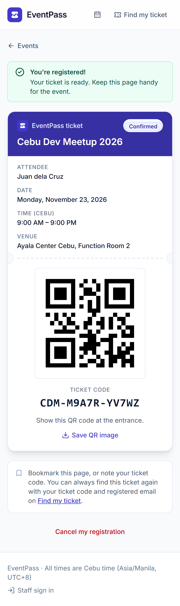
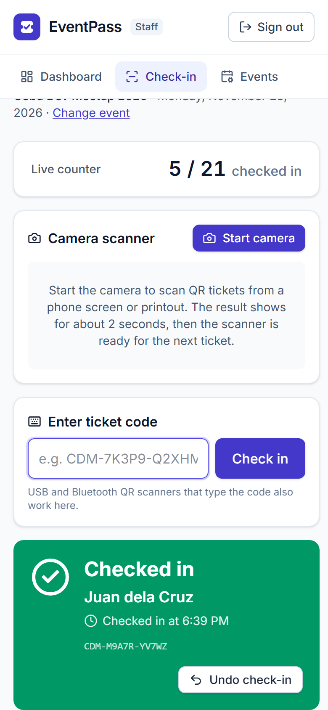
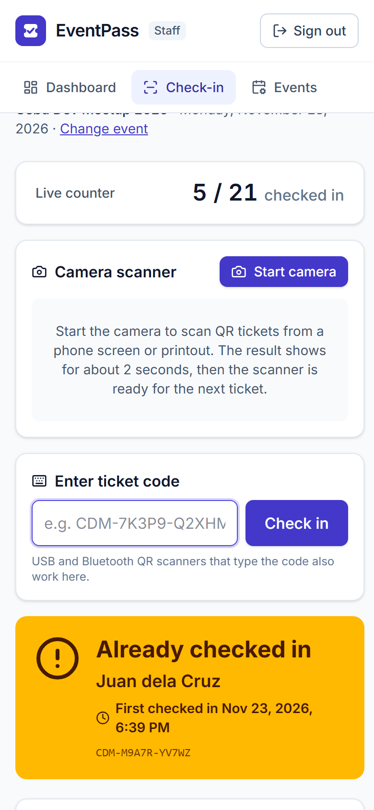
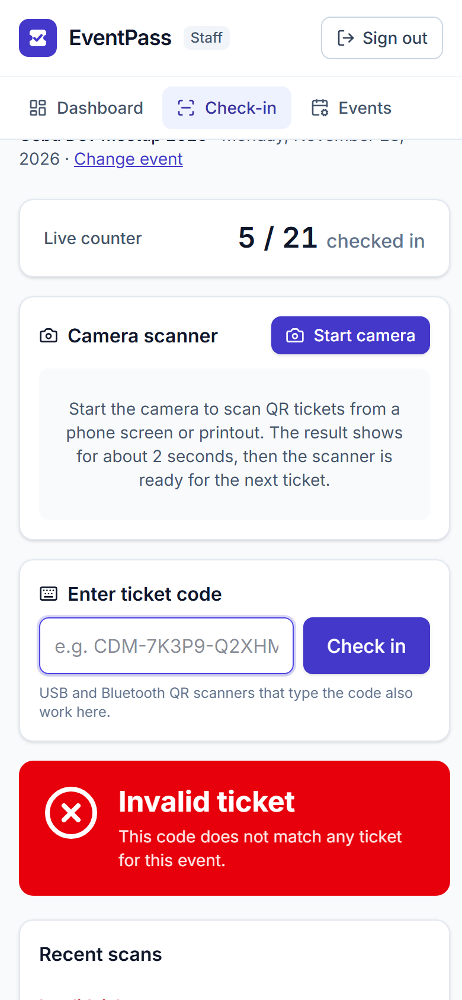

# EventPass — Event Registration with QR Check-in

EventPass is a web app for free community events. Attendees register and get a QR ticket on their phone. Door staff scan the ticket, or type its code, to check people in. Organizers manage events, the waitlist and staff accounts.

This was built for the **CubeTech Innovations Software Development Internship assessment**, using the official demonstration event **Cebu Dev Meetup 2026 · Ayala Center Cebu, Function Room 2 · capacity 30 · Asia/Manila (UTC+8)**.

| | |
|---|---|
| **Level reached** | Levels 1 and 2 fully pass. **Level 3: 4 items verified** (race conditions, secure QR, email, roles + audit log), above the minimum of 3. Camera scanning is implemented but still needs a real-device test, and the app is **not deployed yet**. See the [acceptance checklist](#22-acceptance-checklist). |
| **Stack** | Java 21 · Spring Boot 3.5 · Spring Security · PostgreSQL 17 · Flyway · React 19 · TypeScript · Vite · Tailwind CSS 4 |
| **Tests** | 94 backend (JUnit 5, real PostgreSQL) · 27 frontend (Vitest + React Testing Library) · 28 browser end-to-end (Playwright, phone + desktop) |
| **Deployment URL** | *Not deployed yet.* The Render Blueprint and Dockerfile are ready; see [Deployment](#23-deployment). |

<p>
  
  
  
  
</p>

---

## Contents

1. [Project overview](#1-project-overview)
2. [Business problem](#2-business-problem)
3. [Objectives](#3-objectives)
4. [Technology stack](#4-technology-stack)
5. [System architecture](#5-system-architecture)
6. [Features](#6-features)
7. [User roles and permissions](#7-user-roles-and-permissions)
8. [Database design](#8-database-design)
9. [Business rules and how they are enforced](#9-business-rules-and-how-they-are-enforced)
10. [Concurrency control (last seat and double scans)](#10-concurrency-control)
11. [Ticket security](#11-ticket-security)
12. [Required software](#12-required-software)
13. [Running locally (quick start, no database setup)](#13-running-locally)
14. [Running against your own PostgreSQL](#14-running-against-your-own-postgresql)
15. [Environment variables](#15-environment-variables)
16. [Seed data and demo dates](#16-seed-data-and-demo-dates)
17. [Production build](#17-production-build)
18. [Demo staff credentials](#18-demo-staff-credentials)
19. [API overview](#19-api-overview)
20. [Testing](#20-testing)
21. [Email confirmation](#21-email-confirmation)
22. [Acceptance checklist](#22-acceptance-checklist)
23. [Deployment](#23-deployment)
24. [Known limitations](#24-known-limitations)
25. [Security considerations](#25-security-considerations)

---

## 1. Project overview

| Who | What they can do |
|---|---|
| **Attendee** (no account) | Browse upcoming events, register, get a QR ticket, find the ticket again with ticket code + email (or mobile), join a full event's waitlist, cancel their own registration |
| **Door staff** | Sign in, choose an event, check attendees in by camera QR scan or by typing the code, see the attendee list, undo an accidental check-in |
| **Organizer** | Everything door staff can do, plus create, edit, publish and close events, cancel registrations, promote from the waitlist, export CSV, view the audit log and manage staff accounts |

## 2. Business problem

Small community events usually run registration on spreadsheets or forms, and the door on a printed list. That breaks down in predictable ways:
- events get overbooked;
- the same person registers twice;
- nobody knows who actually showed up;
- the door slows to a crawl as staff search a list;
- two volunteers can admit the same ticket.

EventPass replaces this with one system. It enforces capacity on the server, issues a unique ticket per registration, and gives the door a fast "green / yellow / red" answer for every ticket.

## 3. Objectives

- A complete flow from registration to check-in, with every rule enforced by the server and the database.
- Correct behavior when it matters most: the last seat, two scanners at the door, and duplicate submissions.
- A mobile-first interface that attendees and door staff can use on their phones.
- Clean, tested, documented code that another developer can pick up.

## 4. Technology stack

| Layer | Technology | Why |
|---|---|---|
| Backend | Java 21, Spring Boot 3.5 (Web, Security, Data JPA, Validation, Mail, Actuator) | Mature transaction and security support |
| Database | PostgreSQL 17, Flyway migrations | Row-level locking and partial unique indexes; versioned schema |
| Auth | Session cookie (HttpOnly) + BCrypt (cost 12) + CSRF double-submit cookie | The SPA is served from the same origin, so no tokens are kept in browser storage |
| QR | ZXing (server-side PNG generation); `@zxing/browser` (camera scanning) | Generation and scanning use the same well-tested library family |
| Frontend | React 19, TypeScript, Vite 7, Tailwind CSS 4, React Router 7, React Hook Form + Zod, Lucide icons | Typed, fast builds, accessible forms |
| API docs | springdoc-openapi (Swagger UI at `/api/docs/ui`) | |
| Tests | JUnit 5, Mockito, Spring Boot Test, zonky embedded PostgreSQL, Vitest, React Testing Library, Playwright | Integration tests use a **real PostgreSQL server** without needing Docker |
| Delivery | Multi-stage Dockerfile, docker-compose, Render Blueprint, GitHub Actions CI | |

## 5. System architecture

```
 Browser (phone / laptop)
   │  HTTPS, one origin
   ▼
 Spring Boot application (single deployable jar)
   ├── Static React SPA (/, /events/*, /tickets/*, /staff/*)   ← built by Vite, served from the jar
   ├── REST API  /api/public/**  (attendees, rate-limited)
   │             /api/staff/**   (session-authenticated, role-checked)
   │             /api/auth/**    (sign-in / sign-out / session)
   ├── Services: transactions, business rules, row locks, audit log
   ├── Async mailer (after commit) ──► SMTP sandbox (Mailtrap / Ethereal)
   └── Spring Data JPA ──► PostgreSQL (schema owned by Flyway)
```

**Backend packages** (`backend/src/main/java/com/cubetech/eventpass/`), organized by feature. Each has a controller, a service, a repository and request/response DTOs:

| Package | Responsibility |
|---|---|
| `event` | Events, public listing, staff management, availability (Open / Full / Closed / Ended) |
| `registration` | Registration, ticket lookup, cancellation, waitlist, attendee list, CSV export, QR rendering, ticket codes |
| `checkin` | Door check-in and undo, with the two-step check (event, then status) |
| `staff` | Staff accounts, sign-in, roles |
| `audit` | Audit log written in the same transaction as each action |
| `notification` | Confirmation, waitlist and promotion emails |
| `demo` | Demo data seeder and rolling demo dates |
| `common`, `config` | Error handling (one JSON error shape), rate limiting, security, time zone |

**Frontend** (`frontend/src/`): `pages/public`, `pages/staff`, `components` (shared UI, ticket card, check-in scanner), `lib` (API client, Cebu-time formatting, validation), `auth` (session context and route guard). Staff pages are code-split, so attendees never download the scanner library.

## 6. Features

**Level 1: core**
- Public event list: title, date, start–end time in Cebu time (12-hour clock), venue, short description, and "12 of 30 spots left". Shows **Full** when no seats remain; past events are hidden.
- Event details page with a **Register** button. The button is disabled when the event is full.
- Registration form with field-level errors: required fields, valid email, 11-digit mobile number starting with `09`. The same rules are validated again on the server.
- Unique, unguessable ticket code (e.g. `CDM-7K3P9-Q2XHM`) and a ticket page with a QR code that holds only the ticket code.
- Ticket lookup with ticket code + email (or mobile). Any mismatch shows "Ticket not found." and nothing else.
- Staff sign-in (BCrypt). Staff pages and APIs are protected on the server: signed-out browsers are redirected to sign-in, and the API answers 401 or 403.
- Check-in screen: **Checked in** (green, with name and time), **Already checked in** (yellow, with the original time), **Invalid ticket** (red). Every result uses text and an icon, not just color.
- Attendee list with registered / capacity, checked in / registered, and search by name or ticket code.

**Level 2: intermediate**
- Create, edit, publish and close events. Statuses are Draft, Published and Closed, with server-side validation: end after start, capacity ≥ 1, and capacity can't drop below the number registered.
- FIFO waitlist with a visible position ("You are #3 on the waitlist"). Waitlisted people get no QR ticket, and scanning their code shows **On waitlist — not confirmed**.
- One-click "Promote next in line" for organizers.
- Cancellation by the attendee (from their ticket page) or by an organizer (from the attendee list). It frees one spot, the ticket then scans as **Cancelled**, and checked-in registrations can't be cancelled.
- Operations dashboard per upcoming event: capacity, confirmed, checked in, no-shows (only after the event starts), waitlisted, cancelled. Counts refresh automatically.
- Live check-in counter ("18 / 25 checked in").
- Excel-friendly CSV export: UTF-8 BOM, CRLF, protection against formula injection, and mobile numbers that keep their leading zero.
- Undo check-in, recording who undid it and when (on the registration and in the audit log).

**Level 3: advanced**
- **Camera QR scanning.** Uses the rear camera, shows the result over the camera preview for about 2 seconds, then gets ready for the next scan. Holding the same QR in view is not processed twice. Manual entry remains as a fallback, and blocked or missing cameras get clear guidance.
- **Last-seat and double-scan protection** using PostgreSQL row locks (see [§10](#10-concurrency-control)).
- **Secure ticket codes:** about 50 bits of CSPRNG randomness per code, rate limits on lookup, check-in, registration and sign-in, and no personal data in the QR.
- **Email confirmation** after registration, on joining the waitlist and on promotion. Includes an inline QR image and a ticket link, sent through an SMTP sandbox.
- **Roles and audit log:** Organizer and Door staff roles enforced with `@PreAuthorize`. The audit log records event created / edited / status changed, registration cancelled, waitlist promotion, check-in, undo check-in, and staff account changes.
- **Deployment:** Dockerfile, docker-compose and a Render Blueprint are included. *The app has not been deployed yet.*

## 7. User roles and permissions

All rules are enforced by the server; the UI only hides what a role cannot use.

| Action | Signed out | Door staff | Organizer |
|---|:-:|:-:|:-:|
| Browse events, register, view / cancel own ticket | ✅ | ✅ | ✅ |
| Open any `/staff` page or `/api/staff` endpoint | ❌ (redirect / 401) | ✅ | ✅ |
| View dashboard, events (not drafts), attendee list | ❌ | ✅ | ✅ (incl. drafts) |
| Check in, undo check-in | ❌ | ✅ | ✅ |
| Create / edit / publish / close events | ❌ | ❌ (403) | ✅ |
| Cancel registrations, promote from waitlist, export CSV | ❌ | ❌ (403) | ✅ |
| Audit log, staff accounts | ❌ | ❌ (403) | ✅ |

## 8. Database design

The schema lives in [`backend/src/main/resources/db/migration/V1__initial_schema.sql`](backend/src/main/resources/db/migration/V1__initial_schema.sql) and is applied by Flyway on startup. Hibernate only *validates* the schema (`ddl-auto: validate`).

```
staff_users 1───* events            (created_by)
events      1───* registrations     (event_id, NOT NULL)
staff_users 1───* registrations     (checked_in_by, check_in_undone_by, cancelled_by — nullable)
staff_users 1───* audit_logs        (staff_user_id)
```

| Table | Key columns | Constraints |
|---|---|---|
| `events` | id, title, description, venue, starts_at, ends_at, capacity, status, ticket_prefix, demo_key, created_at, updated_at | `capacity >= 1`, `ends_at > starts_at`, status ∈ {DRAFT, PUBLISHED, CLOSED} |
| `registrations` | id, event_id, full_name, email, mobile, **ticket_code (unique)**, access_token (unique), status, registered_at, confirmed_at, checked_in_at, checked_in_by, check_in_undone_at/by, cancelled_at/by | status ∈ {CONFIRMED, CHECKED_IN, WAITLISTED, CANCELLED}; email stored lower-case; mobile `^09\d{9}$`; CHECKED_IN requires checked_in_at; **partial unique index `(event_id, email) WHERE status <> 'CANCELLED'`** |
| `staff_users` | id, name, username (unique, lower-case), password_hash, role, active, created_at | role ∈ {ORGANIZER, DOOR_STAFF} |
| `audit_logs` | id, staff_user_id, action, target_type, target_id, details, created_at | |

All timestamps are `timestamptz` (absolute instants). Staff enter dates and times in Cebu local time, and the server converts them using `Asia/Manila`. The UI always formats times in `Asia/Manila` with AM/PM, whatever the viewer's device time zone.

## 9. Business rules and how they are enforced

| Rule | Enforcement |
|---|---|
| Capacity counts Confirmed + Checked in; Waitlisted and Cancelled do not | `RegistrationStatus.SEAT_HOLDING`, counted inside the event lock |
| One active registration per email per event; cancelled ones do not block | Service check **and** the partial unique index (last line of defense) |
| Server re-checks capacity on save (never trusts the disabled button) | `RegistrationService.register` counts seats after `SELECT … FOR UPDATE` |
| Check-in: (1) code belongs to the selected event, else **Invalid ticket**; (2) status decides the result | `CheckInService.checkIn` |
| Only Confirmed tickets are checked in, only on the event day (Cebu date) | Otherwise **Not event day** (red) |
| A second scan shows **Already checked in** with the *first* time | Original `checked_in_at` is never overwritten |
| Draft events are invisible to attendees; Closed events refuse registrations | Public queries filter on status; `register` returns 409 |
| End after start, capacity ≥ 1, capacity ≥ registered | Bean Validation + service checks + DB `CHECK` constraints |
| Checked-in registrations cannot be cancelled | `RegistrationRules.requireCancellable` + entity state machine |

## 10. Concurrency control

All seat-changing operations are **serialized per event with a PostgreSQL row lock**. Check-in is serialized **per ticket**:

- **Register / cancel / promote / capacity edit** start with `SELECT … FROM events WHERE id = ? FOR UPDATE` (`EventRepository.findByIdForUpdate`). Inside that transaction the service counts the seats taken, decides between Confirmed, Waitlisted or Full, and inserts or updates the row. Two people racing for the last seat therefore run one after the other. The second one sees `seats taken = capacity` and is waitlisted, or gets "Full" if they didn't choose the waitlist. Confirmed registrations can never exceed capacity.
- **Check-in and undo** read the registration with `SELECT … FOR UPDATE` (`RegistrationRepository.findByTicketCodeForUpdate`). When two phones scan the same ticket at once, the second waits for the first to commit, then sees `CHECKED_IN` and shows **Already checked in** with the original time.
- **Duplicate submissions** of the same email are serialized by the same event lock. The partial unique index rejects any duplicate that bypasses the service.
- **Lock ordering** is always event first, then registration, so no two operations can deadlock. Entities are loaded *by* the locking query, never before it, so a stale copy in Hibernate's first-level cache can't hide a concurrent change.

These guarantees are proven by `ConcurrencyIntegrationTest`, which runs against real PostgreSQL and releases 16 threads at the same instant:

| Scenario | Result |
|---|---|
| 16 simultaneous registrations for the last seat | exactly 1 Confirmed, 15 "Full"; seats taken = capacity |
| 16 simultaneous registrations into 3 seats, waitlist allowed | exactly 3 Confirmed, 13 Waitlisted |
| Same email submitted 8 times at once | exactly 1 registration |
| 16 simultaneous check-ins of one ticket by two staff | exactly 1 "Checked in", 15 "Already checked in", all showing the same original time |
| 6 simultaneous "promote" clicks for 1 free seat | exactly 1 promotion |
| Cancel and check-in racing on one ticket | always a consistent final state |

## 11. Ticket security

- **Ticket code** = `PREFIX-XXXXX-XXXXX`. The ten characters come from `java.security.SecureRandom` over a 31-symbol alphabet without look-alike characters (0/O, 1/I/L), giving 31¹⁰ ≈ 8.2 × 10¹⁴ combinations (~49.5 bits). Codes are never derived from database ids, so `CDM-000001` or a one-character edit of a real code is never valid (both covered by tests).
- **The QR holds only the ticket code**, with no name, email or phone number.
- **Ticket page links** use a separate 256-bit random access token (`/tickets/{token}`). That makes refresh and email links work without exposing a guessable identifier. Lookup by code requires the matching email or mobile, and any mismatch gives the same "Ticket not found."
- **Rate limits** per client per minute (configurable): ticket lookup 10, registration 10, check-in 120 (per staff account), sign-in 10. Exceeding a limit returns HTTP 429 with `Retry-After`.
- Codes are normalized before lookup (case, spaces, missing dashes). Malformed input is rejected before any database query.

## 12. Required software

| Tool | Version used | Needed for |
|---|---|---|
| JDK | 21+ (developed on 23, compiled with `--release 21`) | backend |
| Maven | 3.9+ | backend |
| Node.js / npm | 22 / 10 | frontend |
| PostgreSQL | 15+ (tested with 17) | only if you use your own database (§14) |
| Docker | optional | `docker compose` / image build |

## 13. Running locally

**Quick start, no database setup required.** The dev launcher starts a real embedded PostgreSQL 17 server (data kept in `backend/.local-db/`) and seeds demo data:

```bash
# Terminal 1 — backend on http://localhost:8080 (embedded PostgreSQL on port 54329)
cd backend
mvn spring-boot:test-run

# Terminal 2 — frontend dev server on http://localhost:5173 (proxies /api to :8080)
cd frontend
npm install
npm run dev
```

Open **http://localhost:5173**. Staff sign-in is at **/staff/login** (see [credentials](#18-demo-staff-credentials)).
Camera scanning works on `localhost`. Other devices on your network need HTTPS (see [§23](#23-deployment)).

## 14. Running against your own PostgreSQL

```bash
# 1. Create the database and user (adjust the password)
psql -U postgres -f scripts/create-local-db.sql

# 2. Configure
cp .env.example .env        # set DB_URL / DB_USERNAME / DB_PASSWORD

# 3. Build the SPA into the jar and run (Flyway creates the schema; demo data is seeded)
cd frontend && npm install && npm run build && cd ..
cd backend && mvn -DskipTests package && java -jar target/eventpass.jar
```

Open **http://localhost:8080**. Alternatively, with Docker: `cp .env.example .env`, set `DB_PASSWORD`, then run `docker compose up --build`.

## 15. Environment variables

See [`.env.example`](.env.example). Real values go in `.env`, which is git-ignored, or in your hosting provider's settings.

| Variable | Default | Purpose |
|---|---|---|
| `DB_URL` *or* `DB_HOST`, `DB_PORT`, `DB_NAME` | `jdbc:postgresql://localhost:5432/eventpass` | Database location |
| `DB_USERNAME`, `DB_PASSWORD` | `eventpass` / — | Database credentials |
| `PORT` | `8080` | HTTP port |
| `APP_PUBLIC_BASE_URL` | `http://localhost:8080` | Absolute URL used in email ticket links |
| `COOKIE_SECURE` | `false` | Set `true` in production (HTTPS) |
| `DEMO_SEED` | `true` | Seed demo data into an empty database |
| `DEMO_ROLLING_DATES` | `true` | Keep demo events on current dates (§16) |
| `DEMO_ORGANIZER_PASSWORD`, `DEMO_DOOR_STAFF_PASSWORD` | see §18 | Passwords for the seeded staff accounts |
| `MAIL_ENABLED`, `MAIL_HOST`, `MAIL_PORT`, `MAIL_USERNAME`, `MAIL_PASSWORD`, `MAIL_FROM` | disabled | SMTP sandbox (§21) |
| `RATE_LIMIT_LOOKUP`, `RATE_LIMIT_REGISTRATION`, `RATE_LIMIT_CHECK_IN`, `RATE_LIMIT_LOGIN` | 10 / 10 / 120 / 10 | Requests per client per minute |

## 16. Seed data and demo dates

When the database contains **no events**, the app seeds the data below ([`DemoDataSeeder`](backend/src/main/java/com/cubetech/eventpass/demo/DemoDataSeeder.java)). Existing data is never modified. Attendee records are synthetic and use the reserved `example.com` domain.

| Event | Date (relative to today) | Status | Seats | Purpose |
|---|---|---|---|---|
| **Cebu Dev Meetup 2026** · Ayala Center Cebu, Function Room 2 · 9:00 AM – 9:00 PM | **today** | Published | 18 / 30 (4 checked in) → "12 of 30 spots left" | Registration, tickets, event-day check-in |
| **Mactan Cloud & AI Summit** | +7 days | Published | **12 / 12 + 3 waitlisted** | Seeded **Full** event and waitlist |
| Cebu UX Design Night | +14 days | Published | 19 / 20 | One seat left (last-seat demo) |
| Cebu Startup Pitch Day | +30 days | **Draft** | 0 / 100 | Hidden from attendees |
| Cebu Dev Meetup 2025 | −365 days | Closed | 35 / 40 | Past event (hidden from the public list) |

**Event-day rule and demo dates.** Check-in only works on the event's calendar day (Cebu time). To make that demonstrable on *any* day, `DEMO_ROLLING_DATES=true` runs a job every 15 minutes and at startup. When a **seeded** event has ended, the job moves it forward to its original offset from today, keeping the same times. Cebu Dev Meetup 2026 is therefore always "today", and the full summit stays a week away. Events created by staff are never touched.

To change the date manually, either:
- sign in as the organizer, go to **Events → Cebu Dev Meetup 2026 → Edit**, and set the date; or
- set `DEMO_ROLLING_DATES=false` to keep dates fixed.

**Reset the demo data:**
- *Embedded dev database:* stop the backend, delete `backend/.local-db/`, and start again.
- *Your own PostgreSQL:* `psql "<connection>" -f scripts/reset-demo-data.sql`, then restart. ⚠️ This deletes all data.

## 17. Production build

```bash
cd frontend && npm ci && npm run build          # type-check + build into frontend/dist
cd ../backend && mvn clean package -DskipTests  # packages the SPA into target/eventpass.jar
java -jar target/eventpass.jar                  # with DB_* and other variables set
```

or `docker build -t eventpass .` (multi-stage: Node build → Maven package → JRE runtime as a non-root user).
The health endpoint is `/actuator/health`; Swagger UI is at `/api/docs/ui`.

## 18. Demo staff credentials

| Role | Username | Password |
|---|---|---|
| Organizer | `organizer` | `EventPass#2026` |
| Door staff | `door` | `DoorStaff#2026` |

These defaults are for the demo only. Override them with `DEMO_ORGANIZER_PASSWORD` / `DEMO_DOOR_STAFF_PASSWORD` *before the first start* of a public deployment. Passwords are stored as BCrypt hashes.

## 19. API overview

Full interactive documentation: **`/api/docs/ui`** (OpenAPI JSON at `/api/docs`). Every error has the same shape: `{ status, code, message, fieldErrors?, timestamp }`.

| Method | Path | Auth | Description |
|---|---|---|---|
| GET | `/api/public/events` | — | Upcoming published events with seat availability |
| GET | `/api/public/events/{id}` | — | Event details (drafts → 404) |
| POST | `/api/public/events/{id}/registrations` | — | Register `{fullName, email, mobile, joinWaitlist}` → ticket (201); 409 `DUPLICATE_REGISTRATION` / `EVENT_FULL` / `REGISTRATION_CLOSED` |
| POST | `/api/public/tickets/lookup` | — | `{ticketCode, contact}` → ticket, or 404 "Ticket not found." |
| GET | `/api/public/tickets/{token}` | — | Ticket by link token |
| GET | `/api/public/tickets/{token}/qr.png` | — | QR image (confirmed / checked-in tickets only) |
| POST | `/api/public/tickets/{token}/cancel` | — | Attendee cancellation |
| POST | `/api/auth/login` · `/api/auth/logout` | — / session | Sign in / out |
| GET | `/api/auth/me` | — | Current staff member (204 when signed out) |
| GET | `/api/staff/events` · `/api/staff/events/{id}` | Staff | Events with live statistics |
| POST · PUT | `/api/staff/events` · `/api/staff/events/{id}` | Organizer | Create / update event |
| POST | `/api/staff/events/{id}/status` | Organizer | Publish / close |
| GET | `/api/staff/events/{id}/registrations?q=` | Staff | Attendee list + totals, search by name or code |
| GET | `/api/staff/events/{id}/registrations/export` | Organizer | CSV export |
| POST | `/api/staff/events/{id}/check-ins` | Staff | Check in `{ticketCode}` → result + live counter |
| POST | `/api/staff/registrations/{id}/undo-check-in` | Staff | Undo check-in |
| POST | `/api/staff/registrations/{id}/cancel` | Organizer | Cancel a registration |
| POST | `/api/staff/events/{id}/waitlist/promote` | Organizer | Promote the first waitlisted attendee |
| GET | `/api/staff/audit-logs` | Organizer | Audit log (paged) |
| GET · POST · PATCH | `/api/staff/users` | Organizer | Staff accounts |

All state-changing requests need the `X-XSRF-TOKEN` header, which mirrors the `XSRF-TOKEN` cookie.

## 20. Testing

```bash
cd backend  && mvn test            # 94 tests — unit + integration on embedded PostgreSQL 17 (no Docker)
cd frontend && npm test            # 27 tests — Vitest + React Testing Library
cd frontend && npx playwright install chromium
# with the app running (see §13):
cd frontend && npm run e2e         # 28 browser tests (14 scenarios × phone + desktop)
E2E_BASE_URL=http://localhost:8080 npm run e2e   # against the packaged jar
```

| Suite | What it covers |
|---|---|
| `RegistrationApiTest` | valid registration and ticket format, missing fields, invalid email, 10-digit mobile, non-`09` mobile, duplicates (case-insensitive), full / closed / ended / draft events, seats from DB, CSRF required |
| `TicketApiTest` | lookup by email and by mobile, wrong code / email / edited / sequential → "Ticket not found." with no details, reload by token, **QR decodes to exactly the ticket code**, no QR for waitlisted, cancel and re-register, rate limiting (429) |
| `AuthAndAccessTest` | valid / invalid / disabled sign-in, BCrypt storage, 401 for signed-out APIs, server redirect for signed-out `/staff/**`, door-staff 403s, organizer access, CSRF on login |
| `CheckInApiTest` | Checked in (saved with time and staff), Already checked in with the original time, made-up / edited / sequential codes, other event's ticket, waitlisted, cancelled, not event day, undo recorded in the audit log |
| `EventManagementApiTest` | draft hidden → published visible, end before start, capacity < 1, capacity below registered, close / no back-to-draft, door staff can't see drafts |
| `AttendeeManagementApiTest` | totals from DB, search by name / code, FIFO waitlist and promotion, staff cancel frees a spot, checked-in can't be cancelled, dashboard counts = attendee rows, no-shows only after start, CSV (BOM, quoting, formula injection, leading zeros) |
| `ConcurrencyIntegrationTest` | the race scenarios in §10 (repeated runs) |
| `TicketCodesTest`, `AttendeeCsvWriterTest`, `TicketEmailServiceTest` | code entropy, uniqueness and normalization; CSV escaping; email content (inline QR, ticket link, HTML escaping), disabled mail never "sent" |
| Frontend unit | registration form validation and server errors, **camera permission blocked / missing / insecure context**, **scan → 2 s result → automatic reset with no duplicate processing**, Cebu-time formatting |
| Playwright E2E | the Level 1 and Level 2 acceptance checks in a real browser at phone (Pixel 7) and desktop (1440 px) sizes |

Last results (Nov 23, 2026): **backend 94/94 passed, frontend 27/27 passed, E2E 28/28 passed** (against the packaged production jar).

## 21. Email confirmation

Emails are sent **after the database transaction commits**, asynchronously, so a slow mail server never delays or breaks registration:
- **registration confirmed:** ticket code, inline QR image and a ticket link;
- **joined the waitlist:** position, clearly marked "not confirmed";
- **promoted from the waitlist:** confirmed ticket with QR code.

Mail is **disabled by default**. In that case the log says `Email delivery disabled; skipped …`, and the UI only says an email is "being sent" when mail is actually enabled.

To enable it with Mailtrap (or Ethereal):

```
MAIL_ENABLED=true
MAIL_HOST=sandbox.smtp.mailtrap.io     # Ethereal: smtp.ethereal.email
MAIL_PORT=587
MAIL_USERNAME=…  MAIL_PASSWORD=…        # from the sandbox inbox settings
APP_PUBLIC_BASE_URL=https://your-app-url
```

Verification performed: with an Ethereal sandbox account, a registration, a waitlist join and a promotion produced three emails in the sandbox inbox (checked over IMAP). The confirmation email contained the inline QR image (`Content-ID: <ticket-qr>`) and a working ticket link.

## 22. Acceptance checklist

**How each item was verified:**
- **A:** automated end-to-end test in a real browser (Playwright, phone + desktop)
- **I:** backend integration test on real PostgreSQL
- **U:** frontend component test
- **M:** manual check
- **Not verified:** still needs a real device or a deployment, so it **counts as FAIL until tested**

### Level 1 — Core: **PASS (12/12 verified)**

| # | Check | Result | Verified by |
|---|---|---|---|
| 1 | Register for Cebu Dev Meetup 2026 on a phone-sized screen and see a ticket with a QR code | **PASS** | A (Pixel 7 viewport) |
| 2 | Scan the QR with a phone QR app: it shows the same ticket code | **PASS** (automated) | I: the served QR PNG is decoded with ZXing and equals the ticket code. *A scan with a physical phone app is still recommended before the demo.* |
| 3 | Refresh the browser, then find the ticket again with ticket code + email | **PASS** | A, I |
| 4 | Wrong ticket code or wrong email → "Ticket not found", no details | **PASS** | A, I |
| 5 | Same email twice for one event → second attempt blocked | **PASS** | A, I, U |
| 6 | Bad email and a 10-digit mobile → both show errors | **PASS** | A, I, U |
| 7 | Seeded full event shows "Full" and Register is disabled | **PASS** | A |
| 8 | Open a staff page while signed out → sent to sign-in | **PASS** | A, I (server-side 302) |
| 9 | Check in a valid ticket → green "Checked in" with the name | **PASS** | A, I |
| 10 | Same ticket again → yellow "Already checked in" with the first time | **PASS** | A, I |
| 11 | Made-up code, and a real code from another event → "Invalid ticket" | **PASS** | A, I |
| 12 | Attendee list shows correct registered and checked-in totals | **PASS** | A, I |

### Level 2 — Intermediate: **PASS (10/10 verified)**

| # | Check | Result | Verified by |
|---|---|---|---|
| 1 | Create a Draft event: attendees can't see it. Publish it: it appears | **PASS** | A, I |
| 2 | Save an event whose end time is before its start time → blocked | **PASS** | A, I |
| 3 | Lower capacity below the number registered → blocked with a message | **PASS** | A, I |
| 4 | Fill an event, join the waitlist and see your position | **PASS** | A, I |
| 5 | Scan a waitlisted ticket → "On waitlist — not confirmed" | **PASS** | A, I |
| 6 | Cancel a confirmed registration: spots left +1, scanning it → "Cancelled" | **PASS** | A, I |
| 7 | Promote the first waitlisted person: they now check in successfully | **PASS** | A, I |
| 8 | Cancel a checked-in registration → blocked | **PASS** | A, I |
| 9 | Undo a check-in: the ticket can be checked in again, and the undo is recorded | **PASS** | A, I |
| 10 | Dashboard counts match the attendee list. CSV export opens correctly in Excel | **PASS** (counts and CSV format) | A, I. *The CSV follows Excel's conventions (UTF-8 BOM, CRLF, quoting) and was checked programmatically; it has not been opened in Microsoft Excel itself.* |

### Level 3 — Advanced: **4 items verified (#13, #14, #15, #16); camera (#12) and deployment (#17) pending**

| # | Item | Result | Verified by |
|---|---|---|---|
| 12 | Camera scan of a ticket on another phone's screen: correct result, then ready for the next scan | **Implemented; NOT VERIFIED on a real camera (counts as FAIL until tested)** | U: camera permission errors and the scan → 2 s result → reset flow, with a simulated camera. Needs a test on a phone over HTTPS. |
| 13 | Two browsers register for the last spot at the same moment: only one gets it | **PASS** | I: 16 concurrent requests, repeated |
| 13 | Two devices check in the same ticket at the same moment: only one says "Checked in" | **PASS** | I: 16 concurrent requests, repeated |
| 14 | Guess a sequential or edited ticket code → never valid | **PASS** | I, A |
| 15 | Registration and waitlist-promotion emails arrive in the sandbox inbox with the QR or ticket link | **PASS** | M: Ethereal sandbox, checked over IMAP; I: message content |
| 16 | Door staff cannot create or edit events; Organizer can | **PASS** | A, I |
| 17 | Deployed link works on a phone over HTTPS, including the camera | **FAIL: not deployed yet** | Deployment configuration is ready (§23); it needs a hosting account. |

## 23. Deployment

The app is a **single Docker service plus PostgreSQL**. HTTPS comes from the hosting platform, and camera access needs it.

**Render (Blueprint included: [`render.yaml`](render.yaml))**
1. Push this repository to GitHub.
2. In Render: **New → Blueprint**, then select the repository. This creates the `eventpass` web service (Docker) and the `eventpass-db` PostgreSQL database.
3. When prompted, set:
   - `APP_PUBLIC_BASE_URL` (e.g. `https://eventpass.onrender.com`);
   - `DEMO_ORGANIZER_PASSWORD` and `DEMO_DOOR_STAFF_PASSWORD`;
   - optionally the `MAIL_*` sandbox credentials, with `MAIL_ENABLED=true`.
4. Deploy. On first start, Flyway creates the schema and the demo data is seeded. Check `https://<your-app>/actuator/health` → `{"status":"UP"}`.
5. On a phone, open the URL, register, then sign in as `door` and test **Check-in → Start camera**.

Any Docker host works the same way: run the image with the variables from §15 and `COOKIE_SECURE=true` behind HTTPS.

## 24. Known limitations

- **Not deployed yet**, and camera scanning hasn't been tested on a physical phone (see the checklist). Both require actions outside this repository.
- Free Render plans sleep after inactivity (the first request takes a while), and free PostgreSQL databases expire after 30 days.
- Rate limits are kept in memory per application instance. A horizontally scaled deployment would move them to a shared store such as Redis.
- Staff sessions are stored in server memory, so a restart signs staff out. A deactivated staff member's *existing* session stays valid until it expires (12 h), though they can't sign in again.
- Events are single-day: start and end are on the same date, matching the assessment's date + start time + end time model.
- When a spot frees up, it becomes publicly available immediately (as specified). Promotion from the waitlist is a manual organizer action, not automatic.
- The camera scanner needs a browser with `getUserMedia` (all current mobile browsers) and HTTPS. On older devices, manual entry or a USB/Bluetooth scanner works.

## 25. Security considerations

- Passwords: BCrypt (cost 12) and never logged. Sign-in failures return the same message for unknown users, wrong passwords and disabled accounts.
- Sessions: HttpOnly, SameSite=Lax cookies (`Secure` in production), with a new session ID on every sign-in (session-fixation protection). CSRF uses a double-submit token that is rotated after sign-in.
- Authorization is enforced on the server: URL rules for `/api/staff/**` and `@PreAuthorize` role checks. Hiding UI elements is only a convenience.
- All database access goes through JPA / parameterized queries; search input is escaped for `LIKE`.
- Errors return safe messages through one handler. Stack traces and SQL details are never sent to clients.
- Response headers: Content-Security-Policy (`script-src 'self'`), `X-Frame-Options: DENY`, `X-Content-Type-Options: nosniff`, `Referrer-Policy: same-origin`, and `Permissions-Policy` (camera only for this site).
- Ticket lookup never reveals whether a code exists. The QR contains no personal data. Emails HTML-escape user input.
- CSV export neutralizes spreadsheet formulas.
- Secrets live only in environment variables. `.env` is git-ignored, and [`.env.example`](.env.example) contains placeholders.

---

See [DEMO_GUIDE.md](DEMO_GUIDE.md) for a 3–5 minute demonstration script, and [docs/IMPLEMENTATION_NOTES.md](docs/IMPLEMENTATION_NOTES.md) for the main design decisions.
